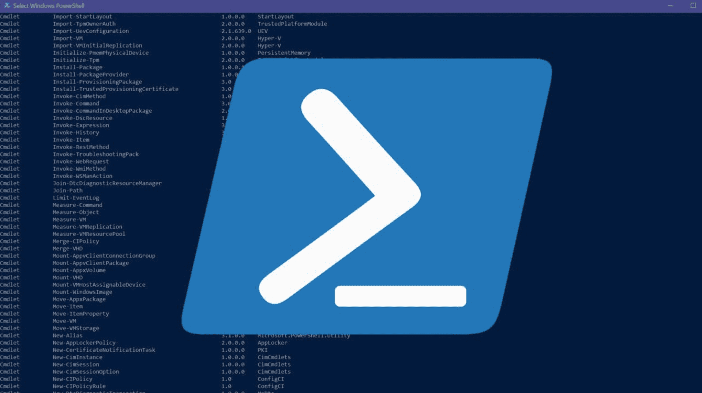

<div align="center">



# RevOps-Kit

**Cross-platform Reverse Engineering & System Optimization Toolkit.**

*Zero-dependency PowerShell & Bash scripts for binary triage and OS tuning.*


</div>

---

## Overview

**RevOps-Kit** provides a structured, dependency-free set of command-line utilities designed for rapid static analysis of executable files (PE/ELF) and safe operating system cleanup. Built to run natively out of the box on both Windows and Linux environments.

## Quick Start

### Windows (PowerShell)
```powershell
git clone https://github.com
cd RevOps-Kit\powershell
.\menu.ps1
```

### Linux / macOS (Bash)
```bash
git clone https://github.com
cd RevOps-Kit/bash
chmod +x menu.sh rev/*.sh opt/*.sh
./menu.sh
```

## Script Catalog

| Script | Platform | Category | Description | Privileges |
| :--- | :--- | :--- | :--- | :--- |
| `Get-BinaryInfo.ps1` | Windows | Reverse | File hashes (SHA256/MD5), signature check, Shannon entropy, string extraction | User |
| `Watch-ProcNet.ps1` | Windows | Reverse | Active TCP connections and non-system loaded DLLs monitor | Admin |
| `Invoke-WinTune.ps1` | Windows | Optimize | Cache cleanup, telemetry disable, restore point creation, `-WhatIf` support | Admin |
| `elf_triage.sh` | Linux | Reverse | ELF headers, security mitigations (NX/Canary), shared libraries, and strings | User |
| `trace_syscalls.sh` | Linux | Reverse | File, network, and process syscall tracing wrapper around `strace` | User |
| `sys_clean.sh` | Linux | Optimize | Systemd journal vacuum, APT/DNF cache cleanup, and dangling Docker image pruning | Root |

## Disclaimer

The reverse engineering utilities in this repository are intended strictly for authorized analysis of your own software, CTF competitions, and educational purposes.
